# pgf-go — Go (Weiqi, Baduk, Igo) diagrams in LaTeX

Boards, positions, game diagrams and tsumego problems of the board game Go for LaTeX, drawn with PGF/TikZ,
read from SGF files or written by hand. With LuaLaTeX it also removes captured stones, finds the territory,
reads the diagrams of Sensei's Library and the AI analysis saved in SGF files.

**Manuals**, with tutorials and the reference of every command and key, and **quick starts** (slides):
English and Español, attached to each [release](https://github.com/gxono/pgf-go/releases/latest).

**Examples**, each one with its drawing and its code: [`doc/examples`](../doc/examples).

pgf-go comes with TeX Live and MiKTeX ([CTAN](https://ctan.org/pkg/pgf-go)). There is also a port to
Typst: [gobanist](https://github.com/gxono/gobanist).

## A position

Stones go by player, marks by shape, and the coordinates are those of Go.

```latex
\documentclass{article}
\usepackage{pgf-go}

\begin{document}
	\begin{goban}[19, partial = K1:T9, label = {at = {south, east}}]
		\stones[b]{L8, S8, R5, S5, P4, R4, M3, P3, N2, O2}
		\stones[w]{L6, S4, S3, Q3, O1, P2, R2}
		\marks[circle]{L8}
		\marks[triangle]{S4}
	\end{goban}
\end{document}
```

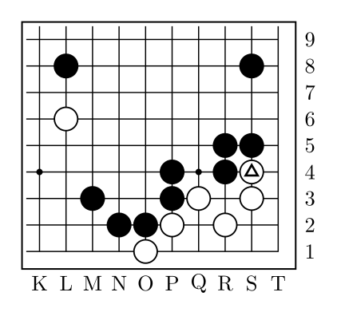

## Moves, captures and notes

Moves are numbered and alternate. With `captures`, the captured stones are removed; with `notes`, a move
played where another one was goes below the board.

```latex
\begin{goban}[7, captures, notes]
	\stones[b]{B3, C2, C4}
	\stones[w]{C3, D2, D4, E3}
	\moves{D3, G6, G5, C3, A6, A5, D3}
\end{goban}

\pgfgomovenotes. Black captured \pgfgoprisoners{b}.
```

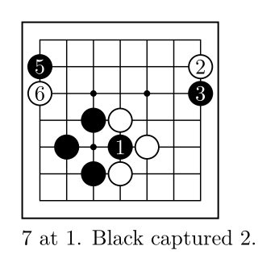

## Marks, arrows and lines

Marks go by shape, and new shapes can be defined with PGF or TikZ code; arrows and lines join two
intersections.

```latex
\begin{goban}[partial = A1:G7, label = {at = {north, west}}]
	\stones[b]{C3, D3, E4, C5}
	\stones[w]{D4, D5, E5, F3}
	\marks[dim]{F3}
	\marks[triangle]{D5}
	\mark[custom = A]{E3}
	\mark[custom = B]{C4}
	\arrow{C5}{C7}
	\arrow[color = red!80!black, bend = 30, shorten = 4pt]{E4}{G5}
	\line[dash = dashed]{A6}{G6}
\end{goban}
```

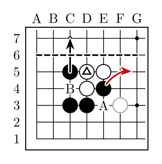

## Boards with a name

A board with a `name` is remembered: `resume` goes on from it, with its stones, its numbers and its turn,
and `\pgfgoview` shows a point or a part of it in the text.

```latex
\begin{goban}[5, name = base]
	\stones[b]{B2, C3, D2}
	\stones[w]{B3, C4, D3}
\end{goban}
\begin{goban}[resume = base]
	\moves[b]{C2, E3}
\end{goban}
\begin{goban}[resume = base]
	\moves[b]{E3, C2}
\end{goban}

The black stone \pgfgoview{base}{C3} is in atari: \pgfgoview{base}{B2:D4}.
```

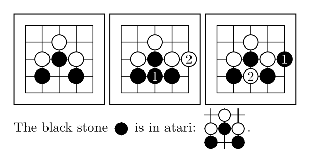

## Territory and score

Coordinates can be abbreviated: `A:C7` is row 7 from A to C, and `D9|-E6--E1` is a path. `auto` finds the
territory, and `\pgfgoscore` counts it.

```latex
\begin{goban}[9, label = {at = {north, west}}]
	\stones[b]{E9|-J7, G8|-F4|-G2--G1, A2-|D1, B1}
	\stones[w]{D9|-E6--E1, F5, A:C7, A:D3, B:C5}
	\territory[dame]{auto}
\end{goban}

Black \pgfgoscore{b}, White \pgfgoscore[komi = 6.5]{w}.
```

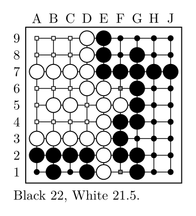

## A game from an SGF file

`\sgfdiagrams` draws a game in diagrams, as in books: each one with its caption, its notes and the comments
of its moves. `\sgfinfo` and `\sgfcomment` bring the data of the file into the text, and `\sgfanimation`
draws the game as an animation.

```latex
\pgfgodefinesgf{game}{commented.sgf}

\begin{document}
	\sgfinfo{game}{PB} against \sgfinfo{game}{PW}, komi \sgfinfo{game}{KM}.

	\sgfdiagrams[step = 9, comments, layout = {columns = 2, width = 11cm}]{game}
\end{document}
```

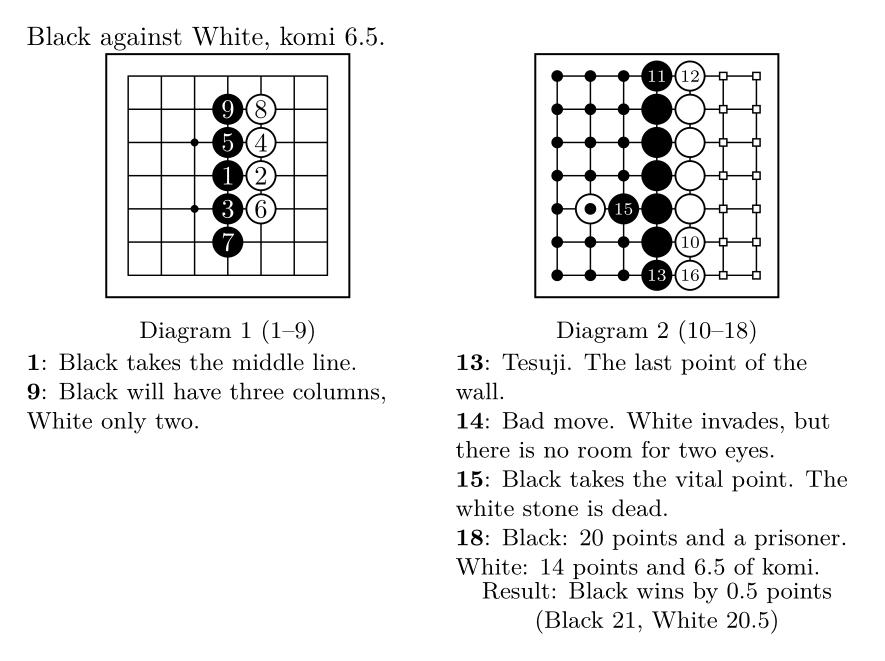

## Diagrams from Sensei's Library

Diagrams written as text, as in Sensei's Library and L19 (lines that start with `$$`), are read like an SGF
file, and every command works with them: `X` and `O` are stones, the numbers are moves, the lowercase
letters are letters on the board. The edges say which corner is drawn.

```latex
\begin{pgfgosgf}{nadare}
$$Bc Nadare joseki
$$  ---------------
$$ | . . . . . . .
$$ | . . . . . . .
$$ | . . . 1 6 . .
$$ | . . 5 4 . . .
$$ | . . 3 2 a . .
$$ | . . . . . . .
\end{pgfgosgf}

\sgfdiagrams{nadare}
```

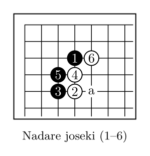

## Other languages

The texts of the package (captions, notes, results) come in several languages, and the coordinates can be
written as in Japanese or Chinese books. SGF files in other encodings (Shift_JIS, GB2312, EUC-KR...) are
converted.

```latex
\usepackage{luatexja}
\usepackage{pgf-go}

\pgfgodefinesgf{kifu}{kifu.sgf}
\pgfgoset{lang = ja, goban = {label = {at = {north, east}, style = japanese}}}

\begin{document}
	\sgfinfo{kifu}{PB}対\sgfinfo{kifu}{PW}、コミ\sgfinfo{kifu}{KM}。

	\sgfdiagrams[step = 9, comments, layout = {columns = 2, width = 11cm}]{kifu}
\end{document}
```

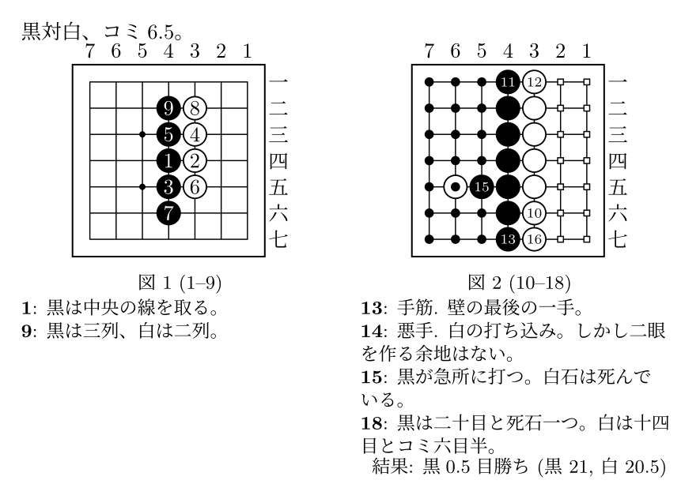

## Problems

`\sgfproblem` draws the statement and a diagram for each line of the solution.

```latex
\sgfproblem[title = Problem 1, layout = {columns = 3, width = 13cm, fit}]{problem.sgf}
```

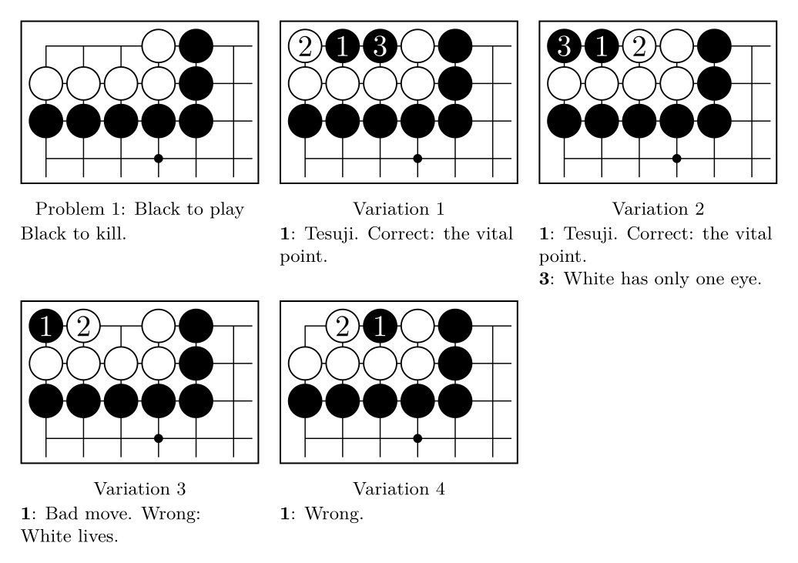

## Styles

Nine profiles come with the package, some with images of wood and stones; the keys of every object can be
changed, for one board or for the whole document with `\pgfgoset`, and a profile of your own is defined
with `\pgfgodefineprofile`.

```latex
\begin{pgfgolayout}[columns = 3, width = 11cm, fit]
	\begin{goban}[7, name = position]
		\stones[b]{C3, D3, E4, C5, D6}
		\stones[w]{D4, D5, E5, F3, E6}
		\marks[circle]{D5}
		\marks[triangle]{E4}
	\end{goban}
	\begin{goban}[resume = {position, marks}, profile = pgfgo]\end{goban}
	\begin{goban}[resume = {position, marks}, profile = pgfgosmooth]\end{goban}
	\begin{goban}[resume = {position, marks}, profile = wain]\end{goban}
	\begin{goban}[resume = {position, marks}, profile = shell]\end{goban}
	\begin{goban}[resume = {position, marks}, profile = yunzi]\end{goban}
	\begin{goban}[resume = {position, marks}, profile = baduktv]\end{goban}
	\begin{goban}[resume = {position, marks}, profile = simple]\end{goban}
	\begin{goban}[resume = {position, marks}, profile = draft]\end{goban}
\end{pgfgolayout}
```

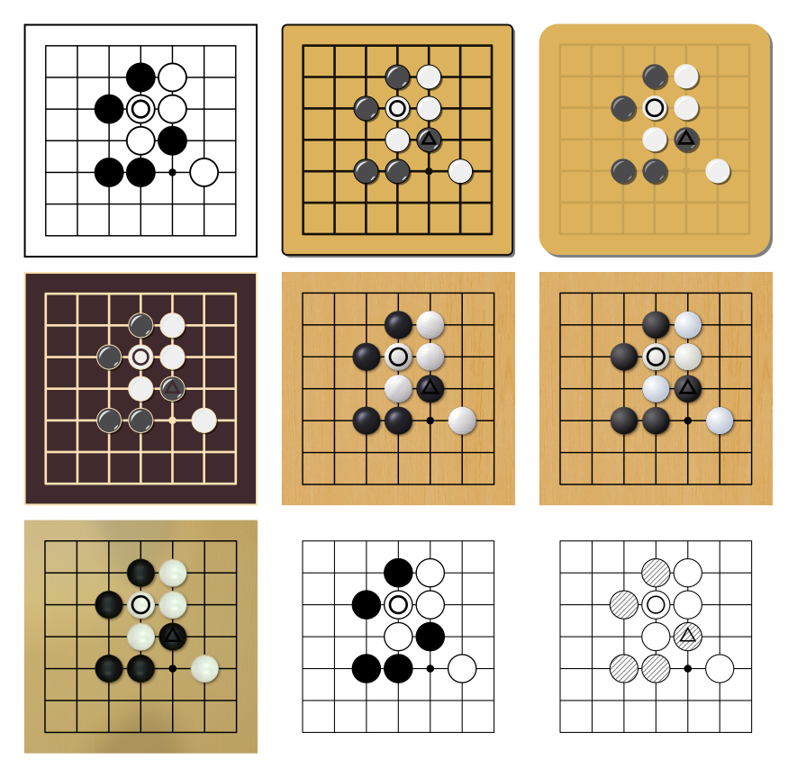

## A joseki dictionary

A variation is chosen by its moves; `variations` draws the commented answers that leave it, each one in its
own diagram, and `partial = auto` shows the part of the board that all of them use.

```latex
\sgfdiagrams[variation = {Q16, R14}, variations = {commented, from = 3}, partial = auto,
	comments, layout = {columns = 3, width = 13cm, fit}]{joseki.sgf}
```

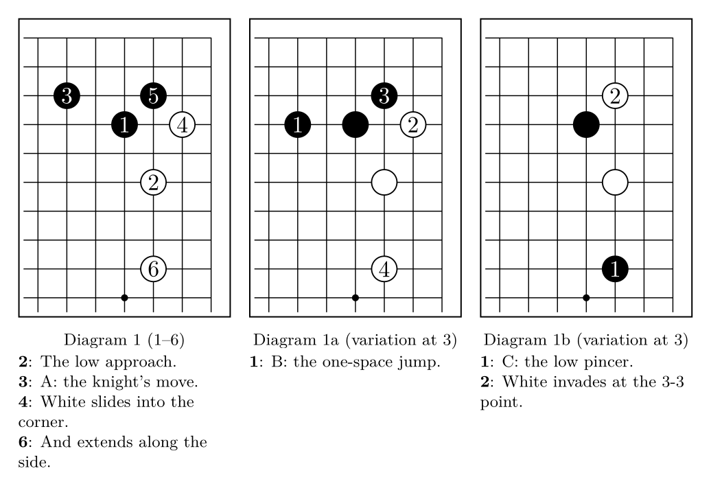

## AI analysis

The analysis that KaTrain, Lizzie, q5Go and Sabaki save in the SGF file: the winrate graph, the worst moves
with the engine's line and its candidate moves, and who owns each point.

```latex
\pgfgodefinesgf{game}{analyzed.sgf}
\pgfgoset{sgf analysis = {colored, mistakes = 2}}

\begin{document}
	\sgfgraph[width = 13cm, height = 2cm]{game}

	\sgfdiagrams[step = 11, layout = {columns = 3, width = 13cm, fit},
		mistake title = {\pgfgovariationmove, loses \pgfgoloss},
		analysis = {line = 5, candidates = 2}]{game}

	The worst moves: \sgfinfo{game}{mistakes}.
\end{document}
```

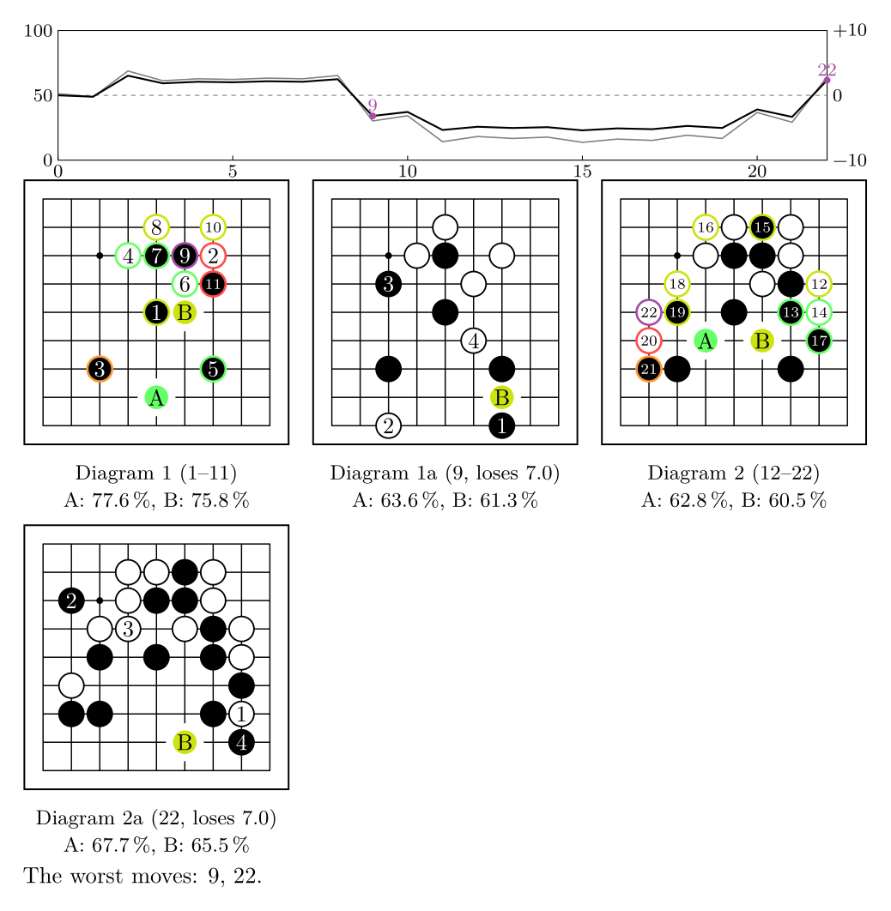

## Features

- Games in SGF: a game on one board, a game in diagrams as in books, with variations, animations and
  problems with their solutions. Also the text diagrams of Sensei's Library and L19.
- The rules, in a Lua kernel: captures, "N at M" notes, territory and score.
- Profiles for the board and the players, with images: wood, slate and shell stones.
- Boards with a name, to follow a variation from a position or to show part of a board in a paragraph.
- Marks, arrows, lines and mark shapes of your own, and TikZ on the board's coordinates.
- The texts in several languages, and Western, Japanese or Chinese coordinates.

## Requirements

LuaLaTeX is recommended (the compute kernel in Lua); with pdfLaTeX the package works, but it cannot read
SGF files, remove captured stones or find the territory by itself. It loads TikZ and xparse;
`\sgfanimation` needs [animate](https://ctan.org/pkg/animate).

## Installation

pgf-go comes with TeX Live and MiKTeX. Otherwise, copy the files of the folder `latex/` to the folder of
your document or to your TeX tree.

## Tests

The tests are in [`tests/`](../tests) (`python tests/run_tests.py`). The images of this README are made by
`python tools/readme.py`.

## License

The code may be distributed and/or modified under the terms of the
[LaTeX Project Public License](https://www.latex-project.org/lppl/), version 1.3c or later. The manuals
may be distributed and/or modified under the LaTeX Project Public License, version 1.3c or later, and/or
the GNU Free Documentation License.

## Author

Jonatán Perren, jonatan (dot) perren (at) gmail (dot) com. Changes in [`CHANGELOG.md`](../CHANGELOG.md).
